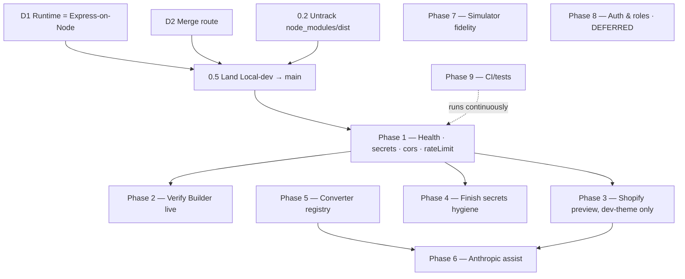

# SectionForge — Remediation & Architecture Plan

**Repo:** `Ecommfox/sectionForge` · **Plan rev:** 4 — 2026-10-13 (rev 1 — 2026-10-09; rev 2/3 — 2026-10-13)
**Status:** Platform **decided** — **axios + Express-on-Node only, no Cloudflare Pages**. Open decisions: merge route (D2), lockfile (D4).
**Purpose:** Reconcile the **already-existing** server-layer implementation with the intended architecture, and close the remaining gaps.

> ### Rev 3 changelog — why this document changed again
>
> Rev 2 was written against a fetch taken minutes earlier. A second fetch immediately after showed that **`origin/Local-dev-235200710` had moved**: two commits that did not exist in the first comparison. They contain **an actual server-layer implementation** (`server/`, `src/api/`, `src/adapters/`) and a **platform pivot**. That invalidates Rev 2 on five points, all corrected here:
>
> | Rev 2 said | Reality (rev 3) |
> |---|---|
> | "There is no server layer at all" | **False.** `server/` + `src/api/` + `src/adapters/` exist on `Local-dev` (`c17b278`, 2026-10-10) |
> | "`Local-dev` carries no unique source — delete it" | **Wrong.** It holds the entire server implementation. It is the *ahead* branch |
> | Arch: Cloudflare Pages Functions + Hono | Implementation is **Express + axios**; the Cloudflare Functions adapter was **deleted** (`6afc25c`) |
> | Phase 1 (server skeleton) is unstarted | **Substantially done**, but with gaps (no `health`, `cors`, `rateLimit`) |
> | Phase 4.2 (stop persisting secrets) is open | **Largely done** — `SettingsContext` now strips secrets from storage |
>
> **The lesson, encoded as §0 rule 9:** a comparison is only valid as of the fetch that produced it. Rev 2's error was arithmetic-correct but *time-stale*. Rev 3 states commit SHAs everywhere so staleness is detectable.

> ### Rev 4 changelog — platform decided
>
> The owner confirmed the direction: **Cloudflare Pages is not used.** The project runs on the **axios + Express-on-Node method only**. Rev 3 still listed "restore CF Pages Functions" as a live option (D1b) and kept a conditional `wrangler.toml`; both are removed here. **D1 is closed**, and the Cloudflare path is dropped from the plan rather than deferred. The empty `functions/api/[[route]].ts` is therefore **dead code** and is deleted (Phase 0) — a cleanup, not a deferral.
> Also added: an explicit **out-of-scope** list in §9 — notably that **CSS / stylesheet work is not part of this plan**.

---

## 0. How to read this plan (the thinking model)

This document is built on nine rules. They explain its *shape*, so you can tell whether an edit improves it.

1. **Evidence-first.** Every claim cites a file, line, or **commit SHA**. Every fact in §1 was produced by a command in §13. Unverified statements are marked *assumed*.
2. **Decisions before work.** Blockers sit in §3, above the plan body. A plan whose blockers are in an appendix is a plan that stalls.
3. **Reconcile before you build.** Rev 1–2 assumed a greenfield server layer. It is not greenfield — it exists and diverges. The work is **reconciliation**: keep what is right, name each gap, close it deliberately. Greenfielding over working code is the most expensive mistake available here. *(This is why rev 3 exists.)*
4. **Order by risk × unblocking power.** The platform is settled (axios/Express — §3 D1), so the keystone is now **Phase 1** (finishing the server layer). The highest-blast-radius item (theme writes) is last among integrations.
5. **One source of truth per fact.** The architecture diagram appears once (§7); the endpoint table once (§9). Phases reference them.
6. **Falsifiable exits.** Each phase ends in a deterministic pass/fail check, not prose.
7. **Measured, not estimated.** Numbers come from `git` output or an explicit assumption.
8. **Assumptions are labelled.** §4 states what we take for granted and what would falsify it.
9. **Staleness is a first-class hazard.** This repo has active concurrent work. Every fact is timestamped by SHA; §13 re-derives §1. *(Rev 2 was invalidated by ignoring this rule.)*

---

## 1. Verified repository state (ground truth)

Re-derived 2026-10-13 from `origin`. **Re-run §13 before trusting this.**

| Ref | Head SHA | Date | Role | Notes |
|---|---|---|---|---|
| `main` | `577cad4` | 2026-10-07 | Baseline | Boots the **vanilla** `src/main.js`; React app is dead code |
| `fix/react-app-entry-wiring` — **PR #3, OPEN** | `514e3e1` | 2026-10-09 | Entry-point fix | Mounts React, adds workbench CSS, one import fix, adds `.gitignore` |
| `Local-dev-235200710` | `6afc25c` | 2026-10-13 | **The ahead branch** | Contains the whole server layer + the platform pivot |

### 1.1 What changed between the last PR and `Local-dev`

`Local-dev-235200710` is **3 commits ahead** of the merge-base with `main` (`577cad4`). In order:

| Commit | Date | Subject | Substance |
|---|---|---|---|
| `c2e2479` | 2026-10-07 | "Updated new interface" | UI/inter­face revision; committed `node_modules/` + `dist/` too |
| `c17b278` | 2026-10-10 | "1 phase of the implementation map done…" | **Implements the server layer**: `server/{index,start}.ts`, `server/middleware/*`, `server/routes/*`, `server/lib/*`, `src/api/*`, `src/adapters/builderEntry.ts`, `functions/api/[[route]].ts`, `docs/IMPLEMENTATION_ROADMAP.md`. Adds Hono-era layout. |
| `6afc25c` | 2026-10-13 | "replaced cloudflare pages with axios" | **Platform pivot.** Deletes `functions/api/[[route]].ts`; drops Hono; adopts **Express 5 + axios**; adds `server/start.ts` (`npm start` serves `dist/` + API from Node); reworks every route/middleware; `package-lock.json` +1355 / `pnpm-lock.yaml` −1016 |

### 1.2 The decisive comparison: `Local-dev` vs the open PR

`git diff --stat origin/fix/react-app-entry-wiring origin/Local-dev-235200710 -- src/` returns a **large** diff — the opposite of the Rev 2 reading. Concretely, `Local-dev` has and PR #3 lacks:

```
server/            index.ts  start.ts  middleware/{errorHandler,logger,requestContext,validate}.ts
                   lib/{builderClient,errors,http,shopifyClient}.ts  routes/{index,builder,shopify}.ts
src/api/           client.ts  builder.ts  shopify.ts  types.ts
src/adapters/      builderEntry.ts
docs/              IMPLEMENTATION_ROADMAP.md
```
…and `Local-dev` **lacks** `functions/` (deleted at `6afc25c`) and `wrangler.toml` (never added).

**Conclusion.** `Local-dev-235200710` is **not** a stale snapshot to discard (Rev 2's error). It is the **only branch with the server implementation**, and it supersedes PR #3's entry-point fix. PR #3 is a *subset* of `Local-dev`'s work (its `index.html`, `style.css`, `SettingsDrawer` changes are all present on `Local-dev`). The real question is not "which to keep" but **how to land `Local-dev` onto `main`** (§3 D2).

### 1.3 Implementation inventory at `6afc25c`

| Area | Present | Verified gaps |
|---|---|---|
| Server app | `server/index.ts` — Express app; `/api` → `requestContext → requestLogger → express.json(64kb) → apiRouter`; static + SPA fallback when a dir is given | No `cors`, no `rateLimit`, no `secrets`, no `auth` middleware |
| Routes | `POST /api/builder/{models,test-connection,entries}`; `POST /api/shopify/test-connection` | **No `/api/health`**; shopify `/themes`,`/preview` → `501 NOT_IMPLEMENTED`; no `/api/anthropic/*` |
| Upstream clients | `builderClient` (Builder Admin GraphQL for models; Content API v3 for entries); `shopifyClient` (themes, dev-role filter, domain/token/themeId validation) | Shopify write path absent by design; **`console.log` in `shopifyClient.ts:77`** |
| Dev/prod parity | `vite.config.js` mounts the same Express app via `ssrLoadModule('/server/index.ts')` | Replaces the old Vite mock — good |
| Secrets handling | `SettingsContext` **strips** `privateKey`/`adminAccessToken`/`anthropicApiKey` before writing storage, and scrubs legacy stored values (`settings.ts:56-115`) | Secrets still live in browser *memory* and are sent to our own API (see §9 note) |
| Tests / CI | — | **No `tests/`, no `.github/`, no test script** |
| Repo hygiene | — | `.gitignore` is one line (`/node_modules/`); **5,582 `node_modules` files + 3 `dist/` files still committed** |

### 1.4 The platform question — now closed

`c17b278` built **Cloudflare Pages Functions + Hono**; `6afc25c` deleted them and moved to **axios + Express on Node**. That direction is **confirmed by the owner** (§3 D1): the project uses the **axios/Express method only**, and **Cloudflare Pages is not used**. This section records the history; it no longer poses an open question.

---

## 2. Executive summary

SectionForge converts Builder.io section JSON into paste-ready Shopify Liquid (markup + scoped CSS + ``), with a LiquidJS preview.

**The premise of rev 1–2 — "there is no server layer" — is no longer true.** As of `c17b278`/`6afc25c` on `Local-dev-235200710`, the app has a real Express API (`server/`), a typed client seam (`src/api/`), a Builder read path, a Shopify connection check, and — importantly — `SettingsContext` already **stops persisting secrets** to browser storage.

What remains is **not** a greenfield build. It is four concrete jobs:

1. **Land the divergent work.** `Local-dev` supersedes `main` + PR #3. Decide and execute the merge (§3 D2).
2. **Settle the platform.** ✅ **Decided** — **axios + Express on Node**, no Cloudflare Pages (§3 D1). The `6afc25c` pivot stands; the abandoned CF path is removed, not revisited.
3. **Close the named gaps.** No `/api/health`; no `cors`/`rateLimit`; shopify `/preview` is `501` while the UI still fakes a URL; one `console.log` leaks a Shopify payload; no tests/CI; `node_modules` + `dist` still tracked.
4. **Finish the integrations** Builder live-verification, Shopify preview writes (dev-theme only), Anthropic decide-or-delete, converter registry, simulator fidelity.

Estimated remaining effort: **~2–3 weeks** for one developer — materially less than rev 1's 3–4 weeks, because the keystone already exists.

---

## 3. Decisions register — resolve these first

| # | Decision | Options | Recommendation | Blocks |
|---|---|---|---|---|
| **D1** ✅ | **Runtime & hosting** — **CLOSED: axios + Express on Node.** The `6afc25c` pivot stands; **Cloudflare Pages is not used.** (History: `c17b278` briefly built CF Pages Functions + Hono; `6afc25c` removed them.) | ~~restore CF Pages~~ ✗ · ~~Hono/edge~~ ✗ | **axios + Express on Node, full stop.** Dev via `vite.config.js` (`ssrLoadModule`), prod via `npm start` serving `dist/` + API. The empty `functions/` leftover is deleted as dead code. | — *(closed)* |
| **D2** 🔴 | **How to land `Local-dev-235200710`** — it supersedes `main` and PR #3 | (a) merge `Local-dev` → `main` directly · (b) new branch off `Local-dev` · (c) keep waiting on PR #3 | **(a) after a cleanup pass (§10 Phase 0).** PR #3 is a subset; close it in favour of the merged result, or retarget it. Do **not** merge PR #3 first — it would conflict with `Local-dev`'s `index.html`. | Phase 0, everything |
| **D3** | **Tracked `node_modules` + `dist`** | (a) `git rm -r --cached` to untrack, keep history · (b) rewrite history to purge | **(a).** Untracking is cheap and immediate; history purge is a separate, optional job | Phase 0 |
| **D4** | **`package-lock.json` vs `pnpm-lock.yaml`** — `6afc25c` deleted `pnpm-lock.yaml` and grew `package-lock.json` | (a) npm/`package-lock.json` (state at head) · (b) pnpm | **(a)** — matches the `npm start`/`npm run dev` scripts at head. Add both lockfiles to `.gitignore` is **wrong**; track exactly one | Phase 0 |
| **D5** | **Shopify write path** — `/preview` is `501` but the UI fabricates a URL | (a) implement dev-theme-only write · (b) delete the fake UI and keep `501` | **(a)**, guarded: refuse `role: main`. Until then, the UI must not claim success | Phase 3 |
| **D6** | **Anthropic** — key field exists; no route, no test | (a) build `assist` for the converter registry · (b) delete the field | **(a)** if the registry lands (Phase 6); otherwise **(b)** | Phase 6/7 |
| **D7** | **Auth & roles** — test profiles in use | (a) leave deferred (as the roadmap doc says) · (b) build real auth | **(a) for now** — defer, but **never present test profiles as an authorization boundary** | Phase 8 (deferred) |

**Hard blockers: D1 and D2.** They gate Phase 0, and Phase 0 gates everything.

---

## 4. Assumptions register

| # | Assumption | Falsified if… | Affects |
|---|---|---|---|
| A1 | **BYOK** — credentials are entered per session and held only in browser memory, sent to our own API | Product wants server-side stored org secrets | §9, Phase 4 |
| A2 | Runtime is **axios + Express on Node** (D1, confirmed) — no Cloudflare Pages | The owner reverses the platform decision | §7, Phase 1 |
| A3 | Shopify must **never** touch the published theme | "Push to live" becomes a feature | Phase 3 |
| A4 | **Single developer**, no parallel streams | Team grows | §12 effort |
| A5 | The tracked `node_modules`/`dist` are **accidental**, not intentional vendoring | They are deliberate | Phase 0 |
| A6 | `main` is the integration target; `Local-dev` is a working branch, not a fork-with-intent | `Local-dev` is meant to remain long-lived | D2 |

---

## 5. Audit recap — findings and current verdicts

Re-adjudicated against `6afc25c`. **Five findings have moved** since rev 1.

| # | Finding | Rev 1 verdict | **Rev 3 verdict** | Evidence at `6afc25c` |
|---|---|---|---|---|
| 1 | Engine not imported → Convert produces nothing | ❌ False | ❌ **False** (unchanged) | `src/App.tsx:11` imports the api client; engine called in `App.tsx`. Root cause was the entry point |
| 2 | Builder entries are mockups; no fetch | ✅ True | 🟠 **Partially closed** | Real read path exists: `server/lib/builderClient.ts`, `server/routes/builder.ts`, `src/api/builder.ts`, `src/adapters/builderEntry.ts`. Not yet verified against a live space; fixtures still ship |
| 3 | Shopify unused; no real preview | ✅ True | 🟠 **Partially closed** | `POST /api/shopify/test-connection` is real (`shopifyClient.verifyShopifyConnection`). **Preview write is `501`** while `PreviewPanel.tsx` still fabricates a URL on non-OK/throw |
| 4 | Anthropic key never used | ✅ True | 🟠 **Half-fixed** | Key is **no longer persisted** to storage (`SettingsContext` strips it) — good. But **no `/api/anthropic/*` route exists**; the field remains inert UI |
| 5 | User roles are mocked | ✅ True | ✅ **True** (unchanged, deferred) | `AuthContext` test profiles; `IMPLEMENTATION_ROADMAP.md` explicitly defers Phase 5 |
| 6 | Connection tests are simulated | ✅ True | 🟠 **Mostly closed** | `SettingsContext` now calls the real endpoints. **Residual:** Builder test posts `{}` to `/models` with an `Authorization` header yet `builderRouter.post('/models')` never reads a body — verify the contract; Shopify success path is real |
| 7 | Liquid simulator approximate | ⚠️ Approx | ⚠️ **Approx** (unchanged) | `src/simulator/liquidSimulator.ts` untouched |
| 8 | Converter is generic | ⚠️ No | ⚠️ **No** (unchanged) | `src/converter/engine.ts` still emits hardcoded hero |
| 9 | No tests / CI / docs | ✅ True | ✅ **True** (partly addressed) | `docs/IMPLEMENTATION_ROADMAP.md` now exists; **still no `tests/`, no `.github/`, no test script** |

### New findings found in rev 3 (not in the original audit)

| # | Finding | Severity | Evidence |
|---|---|---|---|
| N1 | **Secret-bearing payload logged** — the full Shopify themes payload is `console.log`ed | 🔴 High | `server/lib/shopifyClient.ts:77` |
| N2 | **Fabricated success masked as real** — preview falls back to a simulated URL on error | 🔴 High | `src/components/PreviewPanel.tsx` (fallback branches) |
| N3 | **`node_modules/` (5,582 files) + `dist/` tracked**; `.gitignore` is one line | 🟠 Med | `git ls-tree -r 6afc25c`; `.gitignore` = `/node_modules/` |
| N4 | **`/api/health` absent**; no `cors`, `rateLimit`, `secrets`, `auth` middleware | 🟠 Med | `server/routes/index.ts`, `server/index.ts` |
| N5 | **Abandoned CF path left dead code** — empty `functions/api/[[route]].ts`, no `wrangler.toml` (CF Functions were built then deleted) | 🟡 Low *(was Med — closed by D1)* | `c17b278` vs `6afc25c` |
| N6 | **`functions/api/[[route]].ts` exists but is empty** | 🟡 Low | file is 0 bytes at head |

---

## 6. The platform decision — axios + Express on Node (closed)

**Decision (owner-confirmed):** the project uses the **axios + Express-on-Node method only**. **Cloudflare Pages is not part of this strategy.** The `6afc25c` pivot is the final direction, not an episode to re-litigate.

**Why it is the right call:** it removed a dependency on a platform adapter that was never finished, adopted one runtime for both dev and prod, and produced a genuinely simple `vite.config.js` (mount the Express app via `ssrLoadModule`). It also fixed secrets-at-rest as a side effect. Everything the product needs — a same-origin API, server-held upstream credentials, bounded axios clients — works without any edge platform.

**What it leaves to tidy (Phase 0):** the `functions/api/[[route]].ts` **empty file** is dead code from the abandoned path and is **deleted**; there is no `wrangler.toml` and none will be added. The middleware set is thinner than intended (`requestContext`, `logger`, `validate`, `errorHandler` — but no `cors`, `rateLimit`, `secrets`), which Phase 1 closes.

**Deployment shape:** a Node process running `npm start` (serves `dist/` + `/api`) behind a conventional host. No Pages, no Functions, no Wrangler.

---

## 7. Target architecture (as built, with gaps marked)

Reflects `6afc25c` with **D1 closed** (axios + Express on Node). `✅` = present, `⚠️` = partial, `❌` = missing.

```
┌───────────────────────────────────────────────────────────────┐
│  Browser (React SPA)                                          │
│  src/components/**  →  src/api/** (typed axios client)         │
└───────────────────────────┬───────────────────────────────────┘
                            │  same-origin  POST /api/...  (creds in memory only)
┌───────────────────────────▼───────────────────────────────────┐
│  server/index.ts — Express 5 app                              │
│                                                               │
│  /api → requestContext ✅ → requestLogger ✅ →                │
│         express.json(64kb) ✅ → apiRouter ✅                  │
│         ❌ cors   ❌ rateLimit   ❌ secrets   ❌ auth           │
│                                                               │
│  routes/   ❌ /health                                          │
│            ✅ /builder/{models,test-connection,entries}        │
│            ⚠️ /shopify/test-connection · ❌ /themes,/preview   │
│            ❌ /anthropic/*                                     │
│                                                               │
│  lib/      ✅ builderClient (Admin GraphQL + Content v3)       │
│            ⚠️ shopifyClient (read + dev-theme guard; 🔴 log)   │
│  start.ts  ✅ npm start → serves dist/ + API from Node         │
└───────────┬───────────────────────┬───────────────────────────┘
            │ axios (fetch adapter) │ axios (fetch adapter)
     Builder Content/Admin API   Shopify Admin API 2026-07
                                 (read only; writes ❌)
```

**Dev/prod parity** — `vite.config.js` mounts the same Express app via `server.ssrLoadModule('/server/index.ts')`. Dev and prod run identical route code; only the host process differs.

**Design principles**

1. **Credentials are per-session and browser-memory-only.** `SettingsContext` strips `privateKey`, `adminAccessToken`, `anthropicApiKey` before any storage write and scrubs legacy stored values. *Residual:* they are still sent to our own API and held in React state — acceptable for BYOK/A1, but they must never be logged (§10 Phase 1).
2. **One seam.** Components talk only to `src/api/**`. No component calls a third party directly.
3. **Middleware is ordered and explicit** — extend the existing four; do not inline cross-cutting concerns in routes.
4. **Routes own domain logic only.**
5. **No access control in application JavaScript.** In-app roles are deferred (D7).
6. **Failures surface as failures.** No fabricated success — this is why N2 (`PreviewPanel` fallbacks) is a High finding, not cosmetic.

---

## 8. Repository structure (current vs target)

Left = `6afc25c` reality. Right = additions this plan makes. **Not a greenfield tree.**

```
sectionForge/
├─ server/
│  ├─ index.ts                     ✅ Express app assembly
│  ├─ start.ts                     ✅ node/tsx entry: serves dist/ + API
│  ├─ middleware/
│  │  ├─ requestContext.ts         ✅ no-store + X-Request-Id
│  │  ├─ logger.ts                 ✅ structured access log
│  │  ├─ validate.ts               ✅ readJsonObject (content-type + shape)
│  │  ├─ errorHandler.ts           ✅ AppError → JSON envelope
│  │  ├─ secrets.ts                ❌ NEW — keep creds out of logs, per-request scope
│  │  ├─ cors.ts                   ❌ NEW — allow-list (prod)
│  │  └─ rateLimit.ts              ❌ NEW — per-IP/per-key throttle
│  ├─ routes/
│  │  ├─ index.ts                  ✅ mounts builder + shopify
│  │  ├─ health.ts                 ❌ NEW → GET /api/health
│  │  ├─ builder.ts                ✅ models, test-connection, entries
│  │  ├─ shopify.ts                ✅ test-connection · ⚠️ themes, preview (501)
│  │  └─ anthropic.ts              ❌ NEW (only if D6a)
│  └─ lib/
│     ├─ builderClient.ts          ✅
│     ├─ shopifyClient.ts          ✅ (remove the log at :77)
│     ├─ errors.ts                 ✅ AppError
│     └─ http.ts                   ✅ fetchJson (host allow-list, timeouts)
│
├─ src/
│  ├─ api/                         ✅ client.ts · builder.ts · shopify.ts · types.ts
│  │                               (❌ anthropic.ts if D6a)
│  ├─ adapters/builderEntry.ts     ✅
│  ├─ converter/                   ⚠️ engine.ts emits hardcoded hero → registry (Phase 6)
│  ├─ simulator/                   ⚠️ liquidSimulator fidelity (Phase 7)
│  ├─ components/ context/ types/ fixtures/
│  └─ main.tsx
│
├─ functions/api/[[route]].ts      ❌ 0-byte leftover of the abandoned CF path → DELETE (Phase 0)
├─ docs/IMPLEMENTATION_ROADMAP.md  ✅ (repo's own roadmap — reconcile, don't duplicate)
├─ docs/REMEDIATION_PLAN.md        ← this file
├─ tests/                          ❌ NEW — vitest
├─ .github/workflows/ci.yml        ❌ NEW
└─ .gitignore                      ⚠️ 1 line → expand; untrack node_modules/ + dist/
                                   (no wrangler.toml — not a Cloudflare project)
```

**Note on the two docs.** `docs/IMPLEMENTATION_ROADMAP.md` (from `c17b278`) already tracks this work with checkboxes and is *more current* than rev 1–2 of this file. Phase 0 includes merging them so there is **one** roadmap, not two competing ones.

---

## 9. Phase plan

Legend: **Effort** = S (≤½ day), M (1–2 days), L (3+ days), one developer (A4).
Effort is **remaining** work, not greenfield — Phases 1–4 are partly pre-built, so several tasks are now *verify* rather than *build*.
Every **Exit criterion** is a deterministic check (§13).

**Out of scope (explicit).** This plan changes **server, API, security, and converter-logic** only. It does **not** include:
- **CSS / stylesheet work** — no edits to `src/style.css`, no visual polish, no design changes. *(Owner instruction: do not fix CSS files.)*
- **Auth/roles implementation** — deferred (D7).
- **Cloudflare Pages / Wrangler** — the platform is decided against (D1).
- **History rewriting** to purge already-committed `node_modules`/`dist` — untracking only (D3).

### Phase 0 — Land the work & clean the base 🔴 *blocking*

| # | Task | Effort | Depends |
|---|---|---|---|
| 0.1 | **D1 closed (axios/Express).** Confirm D2 — the merge route for `Local-dev` | S | — |
| 0.2 | **Untrack `node_modules/` + `dist/`** — `git rm -r --cached node_modules dist`; expand `.gitignore` (deps, build output, one lockfile rule, `.env*`) | S | D3, D4 |
| 0.3 | **Delete the 0-byte `functions/api/[[route]].ts`** — dead code from the abandoned Cloudflare path (N6) | S | D1 |
| 0.4 | **Merge `docs/IMPLEMENTATION_ROADMAP.md` into this plan** so there is one roadmap, not two | S | — |
| 0.5 | **Land `Local-dev` onto `main`** per D2; retarget/close **PR #3** (it is a subset) | M | 0.1, 0.2 |
| 0.6 | Add `README.md`, `engines`/`.nvmrc`, document `npm run dev` **and** `npm start` | S | — |
| 0.7 | Add `vitest` + one trivial passing test; add `.github/workflows/ci.yml` | S | — |

**Exit criterion:** `main` serves the React app *and* the API (`npm run dev`, `npm start`); `npm run build && npm test` green in CI; `git ls-files | grep -c node_modules` returns `0`.
**Verify (0.2):** `test "$(git ls-files -- node_modules dist | wc -l)" -eq 0`.

---

### Phase 1 — Complete & harden the server layer 🔑 *keystone — mostly built*

| # | Task | Effort | Depends |
|---|---|---|---|
| 1.1 | **Add `GET /api/health`** → `200 {ok, version, uptime}` (`routes/health.ts`) — the readiness probe every deploy needs | S | 0.5 |
| 1.2 | **Remove the secret-bearing log** at `server/lib/shopifyClient.ts:77` (N1) | S | 0.5 |
| 1.3 | Add `middleware/secrets.ts` — scope creds per request; enforce a redaction rule in `logger` | M | 0.5 |
| 1.4 | Add `middleware/cors.ts` (allow-list; no wildcard in prod) and `middleware/rateLimit.ts` | M | 0.5 |
| 1.5 | **Verify the Builder body contract** — `src/api/builder.testConnection` posts `{}` with an `Authorization` header while `POST /api/builder/models` reads no body. Align client and route | S | 0.5 |
| 1.6 | Confirm the **deploy target** — a Node host running `npm start` (`dist/` + `/api`); stand up one environment | S | 0.1 |
| 1.7 | Confirm dev/prod parity: same routes in `vite.config.js` mount and in `npm start` | S | 0.5 |

**Exit criterion:** `GET /api/health` returns `200 {"ok":true}` in **dev and prod**; no credential appears in any log line; CORS/rate-limit behaviour asserted by test.
**Verify:** `curl -s localhost:5173/api/health | jq -e '.ok==true'` and the prod equivalent; `grep -rn 'console.log' server/` returns nothing credential-bearing.

---

### Phase 2 — Verify the Builder path live *(closes #2)*

| # | Task | Effort | Depends |
|---|---|---|---|
| 2.1 | Verify `POST /api/builder/{models,test-connection,entries}` against a **real** public key + space | M | 1.5 |
| 2.2 | Confirm `src/App.tsx` renders returned models/entries and that failure ≠ fixtures | M | 2.1 |
| 2.3 | Harden `adaptBuilderEntry` against real payload variance (optional/variant fields) | M | 2.1 |
| 2.4 | Keep fixtures as an explicit **"Demo mode"** fallback, never as a silent substitute for live data | S | 2.2 |
| 2.5 | Verify error states: bad key, inaccessible model, timeout, malformed upstream, empty result | S | 2.1 |

**Exit criterion:** a real key lists real models/entries and feeds the converter; an invalid key yields a clear error and **never** a connected state.
**Verify:** manual live check recorded (key redacted); `npm run build` green. **Closes #2.**

---

### Phase 3 — Finish Shopify, safely *(closes #3)*

| # | Task | Effort | Depends |
|---|---|---|---|
| 3.1 | Implement `GET /api/shopify/themes` (real list; route currently `501`) | M | 1.4 |
| 3.2 | Implement `POST /api/shopify/preview` — **dev-theme only**; refuse `role: main` with `403` | L | 3.1 |
| 3.3 | **Delete the fabricated preview fallbacks** in `PreviewPanel.tsx` (N2) — surface failures as failures | S | 3.2 |
| 3.4 | Guard: verify the target theme belongs to the store **and** is `development`; fail closed | M | 3.2 |
| 3.5 | Document scopes (`read_themes`, `write_themes`) and the pinned `2026-07` API version (A5) | S | — |

**Exit criterion:** preview writes `sections/sf-<name>.liquid` to a **dev** theme and returns a working `?preview_theme_id=…`; a live-theme target is **hard-refused `403`**; a failed write never yields a URL.
**Verify:** test asserts the guard rejects `role: main`. **Closes #3.** *Highest blast radius — deliberately after the guard.*

---

### Phase 4 — Finish secrets hygiene & connection tests *(closes #4, #6)* 🔐

| # | Task | Effort | Depends |
|---|---|---|---|
| 4.1 | ✅ **Already done** — `SettingsContext` strips secrets from storage and scrubs legacy values. Add a **test** locking the behaviour | S | 0.7 |
| 4.2 | Remove hard-coded credential-shaped defaults from `DEFAULT_SETTINGS` | S | 0.5 |
| 4.3 | Confirm the Anthropic key is never sent anywhere (no route exists — see D6) | S | — |
| 4.4 | Finish real error surfaces in `SettingsDrawer` (401/403/timeout/unavailable) | S | 2.1, 3.1 |
| 4.5 | Assert no secret reaches build output, browser storage, URLs, or server logs | M | 1.3 |

**Exit criterion:** no private credential in storage, bundle, URL, response, or log; invalid credentials produce specific, real errors.
**Verify:** a test asserts the persisted settings blob contains none of `/privateKey|adminAccessToken|anthropicApiKey/` with a non-empty value. **Closes #4, #6.**

---

### Phase 5 — Converter generality *(closes #8)*

| # | Task | Effort | Depends |
|---|---|---|---|
| 5.1 | `src/converter/registry.ts` — Builder component name → Liquid partial + scoped CSS | L | — |
| 5.2 | Move the hardcoded hero markup/CSS out of `engine.ts` into a registry entry | M | 5.1 |
| 5.3 | Use the existing `unsupported` severity for unmapped components | S | 5.1 |
| 5.4 | Add ≥1 more component type (e.g. `benefit-grid`, `announcement-bar`) | M | 5.1 |

**Exit criterion:** correct output for ≥2 component types with **no engine edit** (golden tests). **Closes #8.**

---

### Phase 6 — Anthropic: **build or delete** *(finding #4, D6)*

| # | Task | Effort | Depends |
|---|---|---|---|
| 6.1 | **Preferred:** `routes/anthropic.ts` + `src/api/anthropic.ts` — AI-assist mapping unmapped components to Liquid (pairs with 5.1) | M | 5.1, 1.3 |
| 6.2 | Or remove the key field and its UI entirely | S | D6 |

**Exit criterion:** the setting either *does* something or no longer exists. **No inert controls.**

---

### Phase 7 — Simulator fidelity *(finding #7)*

| # | Task | Effort | Depends |
|---|---|---|---|
| 7.1 | Align `image_url` (real width/CDN semantics) and `image_tag` (parse args, not regex) | M | — |
| 7.2 | Golden tests: fixture → expected HTML | M | 7.1 |
| 7.3 | Document remaining divergences as explicit limits | S | — |

**Exit criterion:** documented fidelity guarantees + golden tests. **Partially closes #7.**

---

### Phase 8 — Auth & roles *(finding #5, D7 — deferred)*

| # | Task | Effort | Depends |
|---|---|---|---|
| 8.1 | Replace `TEST_PROFILES` with real identity | M–L | D7 |
| 8.2 | Role → capability map (`agency_dev` may push; `store_merchant` may not) | M | 8.1 |
| 8.3 | Enforce capabilities **server-side** in `middleware/auth.ts` on mutating routes | M | 8.1 |
| 8.4 | Remove the default-profile auto-login | S | 8.1 |

**Exit criterion:** under-privileged callers are rejected by the **server** (`401`/`403`), not by hidden UI.
**Note:** signed-in *route admission* for a hosted deploy is a platform concern — use the access-rules descriptor (AccessRulesRead → Update → Validate → Test), **never** application JavaScript. This phase is in-app roles only.

---

### Phase 9 — Quality gate *(closes #9)*

| # | Task | Effort | Depends |
|---|---|---|---|
| 9.1 | Unit tests: `sanitize`, `schemaMapper`, `stylesProcessor`, `engine` | M | 0.7 |
| 9.2 | Server tests: `errorHandler`, `validate`, `secrets`, `cors`, `rateLimit` | M | 1.3 |
| 9.3 | CI: build + test + typecheck on every PR | S | 0.7 |
| 9.4 | Reconcile README + architecture docs with the shipped reality | S | 0.4 |

**Exit criterion:** CI green on every PR. **Closes #9.** *Harness lands in 0.7; this phase is where coverage reaches adequate.*

---

## 10. Endpoint contracts (as built vs target)

Errors use one envelope: `{ "error": { "code", "message" } }` (`server/lib/errors.ts`, `errorHandler.ts`).
`✅` implemented · `⚠️` partial · `❌` missing.

| Method | Path | Body | Status |
|---|---|---|---|
| `GET` | `/api/health` | — | ❌ **add** → `200 {ok, version, uptime}` |
| `POST` | `/api/builder/models` | header `Authorization: Bearer <privateKey>` | ✅ → `{models:[{id,name,kind}]}` |
| `POST` | `/api/builder/test-connection` | same header | ✅ → `{success, message, modelCount}` |
| `POST` | `/api/builder/entries` | `{apiKey, modelName}` | ✅ → `{entries:[…]}` |
| `GET` | `/api/shopify/themes` | `?storeDomain=&adminToken=` | ❌ `501` → implement |
| `POST` | `/api/shopify/test-connection` | `{storeDomain, adminAccessToken, themeId?}` | ✅ → `{success, message, developmentThemes}` |
| `POST` | `/api/shopify/preview` | `{themeId, name, liquid, css}` | ❌ `501` → implement (dev-theme only) |
| `POST` | `/api/anthropic/test` | `{apiKey}` | ❌ only if D6a |
| `POST` | `/api/anthropic/assist` | `{apiKey, prompt}` | ❌ only if D6a |

**Codes in use:** `400` invalid request/credential · `401` unauthorized upstream · `403` live-theme denied · `404` dev-theme not found · `405` method not allowed · `413` payload too large · `415` unsupported media type · `500` internal · `501` not implemented · `502/503/504` upstream failure/timeout.

**Credential-transport note (A1).** Credentials travel in `Authorization` (Builder private key) and in the JSON body (Shopify token). This is acceptable for BYOK same-origin, **provided** the logger never serializes request bodies/headers and no secret is logged. That is why 1.3 (`secrets.ts` + redaction) is a Phase-1 task, not a nicety.

---

## 11. Dependency graph & sequencing



**Recommended order:** `0 → 1 → 2 → 4 → 3 → 5 → 6 → 7 → 9`, with `8` deferred.

Rationale: Phase 1 finishes the keystone that already exists. Phase 2 is the first *visible* win and needs no write access. Phase 4 is security-critical and cheap now that storage is already hardened. Phase 3 carries the highest blast radius, so it follows the guard work. Phase 8 is deferred by D7.

---

## 12. Risks & mitigations

| Risk | Impact | Mitigation |
|---|---|---|
| **Re-litigating the platform mid-build** (the pivot already happened once) | 🟡 Low *(was High)* | D1 is **closed** — axios/Express, no Cloudflare Pages. The `server/index.ts` seam keeps the code portable if that ever changes |
| Admin token misuse (live-theme overwrite) | 🔴 High | Dev-theme allow-list in `shopifyClient`; refuse `role: main`; fail closed |
| Secrets leaked to logs | 🔴 High | Delete `shopifyClient.ts:77` log; `secrets.ts` + redacting logger; no-body-logging rule |
| **Fabricated success masking real failure** | 🔴 High | Delete `PreviewPanel` fallbacks (3.3); UI must not claim success on error |
| Merge conflict `Local-dev` ↔ PR #3 (`index.html`, `style.css`) | 🟠 Med | Land `Local-dev` first; **retarget/close PR #3** (D2) |
| Tracked `node_modules`/`dist` inflating every diff | 🟠 Med | Phase 0.2 untrack (history purge optional, separate) |
| Builder payload shape ≠ fixtures | 🟠 Med | Harden `adaptBuilderEntry`; live verification (2.3) |
| Two competing roadmap docs drift apart | 🟡 Low | Merge into one in 0.4 |
| Shopify API version drift | 🟡 Low | Pinned `2026-07`, centralised in `shopifyClient` |
| Rate limits (Builder/Shopify) | 🟡 Low | `rateLimit` middleware + upstream backoff |
| Converter refactor churn | 🟡 Low | Golden tests before refactor |

---

## 13. Verification commands (re-derive §1)

Run these to check this plan against reality. **If they disagree with §1, the plan is stale — fix the plan, not the commands.**

```bash
cd /home/user/webapp

# Branch heads — compare SHAs with §1.1 (Local-dev moved once already)
git fetch origin --prune
git ls-remote --heads origin

# Is Local-dev still ahead of main, and by how many commits?
git log --oneline origin/main..origin/Local-dev-235200710

# The commits that implement the server layer
git show --stat c17b278 | head -40
git show --stat 6afc25c | head -40

# The server layer really exists? (expect server/, src/api/, src/adapters/)
git ls-tree -r --name-only origin/Local-dev-235200710 | grep -E '^(server|src/api|src/adapters)/'

# Gaps claimed in §1.3
git grep -n 'console.log'      origin/Local-dev-235200710 -- server   # → shopifyClient.ts:77
git grep -n 'health'           origin/Local-dev-235200710 -- server   # → (none)
git show origin/Local-dev-235200710:server/routes/shopify.ts | grep -n 'NOT_IMPLEMENTED'

# Tracked bloat claimed in §1.3 (N3)
git ls-tree -r --name-only origin/Local-dev-235200710 | grep -c node_modules   # → 5582
git show origin/Local-dev-235200710:.gitignore                                  # → /node_modules/

# Secrets really stripped at rest? (§1.3)
git show origin/Local-dev-235200710:src/context/SettingsContext.tsx | grep -n "privateKey: ''"

# Platform pivot evidence
git diff c17b278 6afc25c --stat -- functions package.json
```

---

## 14. Acceptance criteria & effort

### Project-level acceptance

- [ ] D1/D2 resolved; `Local-dev` landed on `main`; PR #3 retargeted or closed.
- [ ] `node_modules/` and `dist/` untracked; one lockfile tracked.
- [ ] `GET /api/health` returns `200 {ok:true}` in dev and prod.
- [ ] No credential in storage, bundle, URL, response, or logs (incl. `shopifyClient` log removed).
- [ ] Builder: real models/entries from a real key; failure ≠ fixtures.
- [ ] Shopify: preview writes to a dev theme only; live theme hard-refused; no fabricated URLs.
- [ ] Connection tests perform real verification and surface real errors.
- [ ] Converter supports ≥2 component types generically.
- [ ] Anthropic setting does something or is gone.
- [ ] CI green: build + typecheck + tests on every PR.

### Effort summary (remaining work)

| Phase | Effort | Status at `6afc25c` | Closes |
|---|---|---|---|
| 0 — Land & clean | M | — | — |
| 1 — Finish server layer 🔑 | M | ~60% built | unblocks 2/3/4 |
| 2 — Builder verification | M | ~70% built | #2 |
| 3 — Shopify preview | L | ~40% built | #3 |
| 4 — Secrets hygiene 🔐 | S | ~70% built | #4, #6 |
| 5 — Converter registry | L | not started | #8 |
| 6 — Anthropic | M | not started | #4 |
| 7 — Simulator fidelity | M | not started | #7 |
| 8 — Auth & roles (deferred) | L | not started | #5 |
| 9 — CI/tests | M | not started | #9 |

**Sequential estimate:** **~2–3 weeks** for one developer (A4), excluding the deferred Phase 8. Rev 1 said 3–4 weeks from zero; the difference is the server layer that `c17b278` already built.

---

## 15. Immediate next slice

1. **Answer D1 (Express-on-Node) and D2 (merge route).** They gate everything.
2. **Phase 0.2–0.5** — untrack `node_modules`/`dist`, delete the empty `functions` file, merge the two roadmap docs, land `Local-dev` on `main`, retarget/close PR #3.
3. **Phase 1.1 + 1.2 first** — `/api/health` and remove the credential log. Small, high-value, unblocks deploy verification and closes a live leak.
4. **Phase 2** — verify Builder live: the first demoable win, and it needs no write access.
5. **Phase 4.1** — lock the already-correct storage behaviour with a test before touching anything near it.

---

## 16. Definition of done

A task is done when: the code is committed with a conventional message; the phase's **exit criterion** passes (§9); no secret is logged or persisted; the PR is reviewed; and — for user-facing changes — the behaviour is verified in the **deployed environment**, not just locally.

---

*Rev 1: 2026-10-09 — audit-consolidation draft. **Rev 2: 2026-10-13** — corrected the `Local-dev` file count to 5,582 (measured); added decisions up front. **Rev 3: 2026-10-13** — re-baselined after two new `Local-dev` commits (`c17b278` server layer, `6afc25c` Cloudflare→Express pivot) invalidated rev 2's "no server layer" premise; corrected the branch-and-merge recommendation, added findings N1–N6, and made staleness a first-class rule (§0 rule 9, §13). **Rev 4: 2026-10-13** — **platform closed: axios + Express-on-Node only, no Cloudflare Pages** (D1 resolved by owner; CF options and `wrangler.toml` removed; empty `functions/` file is now deletion, not deferral); added the explicit **out-of-scope** list (§9 — **no CSS/stylesheet work**). No application code was changed in preparing this document.*
